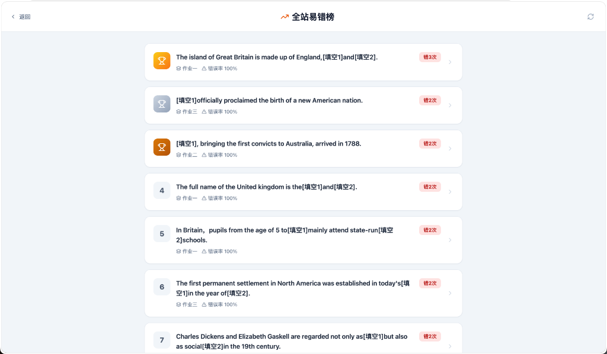
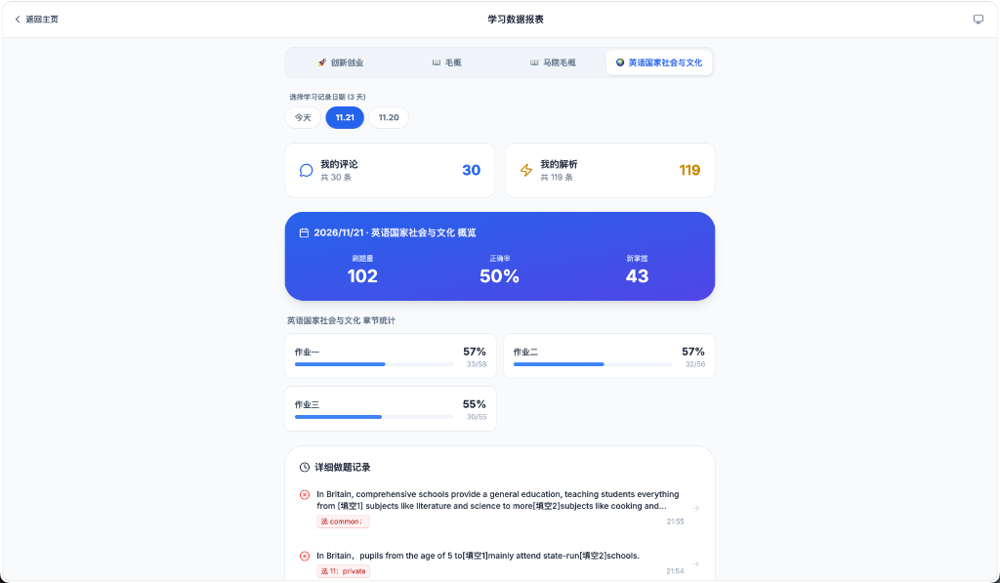

# HFUT 综合刷题系统 (v5.2.6)

面向合肥工业大学课程的在线多科目刷题与背题系统，支持多题型练习、自定义题库导入、AI 出题、云端同步与社区共建解析。

## 界面预览

### 科目选择首页


### 刷题控制台


### 全站易错榜与学习数据报表
| 全站易错榜 | 学习数据报表 |
| --- | --- |
|  |  |

### 上传自定义题库


## 主要功能

### 核心刷题与学习
- **多科目题库支持**：内置多门课程题库，支持一键切换科目与分章节练习
- **多题型支持**：
  - **单选题 / 多选题 / 判断题**
  - **填空题**：支持真实输入框作答、多空与多等价答案匹配、大小写与标点容错；支持**逐字提示**（首次显示首单词首字母，每次点击多显示一个字符；使用提示后答对不计入「已掌握」）
  - **简答题**
- **多种练习模式**：
  - **刷题模式**：支持按「全部 / 未做 / 错题 / 收藏」筛选，支持顺序或乱序
  - **背题模式**：直接展示答案与解析，筛选「未做」时自动过滤已背题目
  - **错题攻坚 / 收藏夹**：自动归集错题与收藏题目，支持针对性复习
- **进度与数据报表**：本地 + 云端统计刷题数、掌握率与正确率，支持查看历史记录与数据报表

### 扩展与社区能力
- **自定义题库上传**：支持解析 Excel（`.xlsx`/`.xls`）、Word（`.docx`）、文本/JSON 等格式的自定义题库
- **AI 辅助出题**：支持配置自定义 OpenAI 兼容接口生成题目
- **题库搜索与筛选**：支持按关键词、章节、题型与答题状态快速检索题目
- **易错题排行榜**：按科目查看全站高频错题排行
- **题目讨论与共建解析**：支持在题目下方发表评论、贡献解析与投票点赞
- **外观与离线体验**：支持浅色 / 深色模式切换、响应式移动端适配、PWA 离线缓存与版本更新提醒

## HFUT-CS-Online 扩展账号云同步

本项目的 Cloudflare Worker 后端也为独立项目 [HFUT-CS-Online-Sync-Extension](https://github.com/Junpgle/HFUT-CS-Online-Sync-Extension) 提供**可选的账号同步服务**。

- 复用 Question-Bank 原有的用户名、bcrypt 密码验证、邮件激活和 30 天 JWT，无需注册第二套账号；浏览器扩展需单独登录一次。
- `https://worker.junpgle.me/api/site-sync/exchange`：受现有 JWT 中间件保护，双向合并题目状态、阅读位置和课程同步控制。对同一用户使用乐观并发版本检查，防止不同设备覆盖更新。
- `POST /api/site-sync/course`：禁用或恢复指定课程同步；`DELETE /api/site-sync`：删除当前登录用户的全部独立云学习记录。
- 数据独立保存在 D1 的 `SiteSyncState` 表，不修改已有的 `UserProgress`、`Users` 等题库业务表。
- 扩展独立云同步默认关闭，只有用户主动登录后才上传学习记录；JWT 留在扩展本地存储，明文密码不持久保存。
- 服务每个账号的学习快照上限约 190 KB，支持登录后手动同步，前端正常使用浏览器存储且服务器故障时不丢失已有本地记录。
- 仅允许指定浏览器扩展来源与题库现有前端域名；所有读写仍必须验证 JWT，CORS 不是身份认证替代品。

数据库迁移语句已附于 `hfut-backend/schema.sql`，线上 D1 `hfut-db` 已新增该表。扩展的 Microsoft Edge 商店正式包需由扩展项目另行提交更新和审核，详情见扩展的 [隐私政策](https://github.com/Junpgle/HFUT-CS-Online-Sync-Extension/blob/main/PRIVACY.md)。

## 账号注册与邮箱验证码找回密码

Question-Bank 账号同时用于本题库和 [HFUT-CS-Online 全站学习同步扩展](https://github.com/Junpgle/HFUT-CS-Online-Sync-Extension)。两个产品共用用户名、密码和 JWT 鉴权；扩展中需单独登录。

- **注册新账号：** https://qbank.junpgle.me/#/register
- **修改／忘记密码：** https://qbank.junpgle.me/#/reset-password
- **登录入口：** https://qbank.junpgle.me/#/

注册时发送邮箱激活验证码。修改或找回密码时，输入**已激活账号的绑定邮箱**，即可通过 Resend 获得独立的一次性 6 位验证码；验证码有效期 **10 分钟**，错误尝试最多 **5 次**，重复发送至少间隔 **60 秒**，并对邮箱及请求来源设置额外发送频率限制。新密码要求 **8–128 位**，修改成功后原有题库网页和扩展端 JWT 均失效，需要在所有设备重新登录。

相关 API：`POST /api/password-reset/request`（提交邮箱获取验证码，统一响应不透露账号是否存在）和 `POST /api/password-reset/confirm`（提交邮箱、验证码及新密码）。数据库中的 `PasswordResetRequests` 独立保存验证码的 HMAC 摘要、有效期及错误次数；`PasswordResetIpRate` 使用带密钥摘要限制异常请求，不存储明文来源 IP。密码仍按 bcrypt 保存；重置流程不会读取或删除题库成绩及 HFUT-CS-Online 学习记录。

线上 D1 `hfut-db` 已增加上述两张表及 `Users.token_version` 列，原有账号无需重新注册。

## 内置题库

| 科目 | 章节/说明 | 数据文件 |
| --- | --- | --- |
| 创新创业 | 第一讲 ~ 第七讲 + 经典旧题库 | `questions/创新创业基础第一~七讲习题.xlsx`、`questions_old.xls` |
| 毛泽东思想和中国特色社会主义理论体系概论 | 导论 + 第一章 ~ 第八章 | `questions/maogai_full.json` |
| 合工大智慧马院-毛概 | 综合题库 | `hgdmy-maogai.json` |
| 英语国家社会与文化 | 作业一 ~ 作业三（含多空填空题） | `questions/english-culture.json` |

## 技术栈

- **前端 (`hfut-quiz_cf/`)**：React 19、Vite 7、Tailwind CSS 3、React Router 7、Lucide React、React Markdown、`vite-plugin-pwa`
- **文档解析**：`xlsx`、`mammoth`、`jszip`
- **本地存储**：LocalForage (IndexedDB) + LocalStorage
- **后端 (`hfut-backend/`)**：Cloudflare Workers + Hono + Cloudflare D1 + Resend

## 目录结构

```text
HFUT---Innovation-and-Entrepreneurship-Question-Bank/
├── hfut-quiz_cf/                 # 当前主前端项目（React + Vite + PWA）
│   ├── src/
│   │   ├── App.jsx               # 主应用与刷题状态管理
│   │   ├── components/           # 题目面板、导航、搜索、更新弹窗等组件
│   │   ├── config/quizConfig.js  # 版本号与科目/章节配置
│   │   ├── utils/                # 填空判题/提示、题型、存储、更新工具
│   │   ├── CustomUploadModal.jsx # 自定义题库导入
│   │   ├── AIQuestionModal.jsx   # AI 出题弹窗
│   │   ├── RankingPage.jsx       # 易错题排行榜
│   │   └── Report.jsx            # 数据报表页
│   └── package.json
├── hfut-backend/                 # Cloudflare Workers + D1 后端服务
│   ├── src/index.js
│   ├── schema.sql
│   └── wrangler.toml
├── questions/                    # 题库数据文件
└── hfut-quiz/                    # 旧版前端目录
```

## 快速开始

### 前端开发 (`hfut-quiz_cf`)

```bash
git clone https://github.com/Junpgle/HFUT---Innovation-and-Entrepreneurship-Question-Bank.git
cd HFUT---Innovation-and-Entrepreneurship-Question-Bank/hfut-quiz_cf

npm install
npm run dev      # 启动本地开发服务器
npm run build    # 构建生产版本
npm run preview  # 预览生产构建
```

### 后端开发 (`hfut-backend`)

```bash
cd hfut-backend
npm install
npm run dev      # 启动 wrangler 本地调试
npm run deploy   # 部署至 Cloudflare Workers
```

## 更新日志（近期）

- **v5.2.3**：填空题新增逐字提示功能（每次点击多显示一个字符，使用提示后答对不计入掌握）
- **v5.2.2**：修复更新检测并新增应用版本号展示
- **v5.2.x**：上线真实填空题作答与判题、新增题目收藏功能、修复黑夜模式 Markdown 样式与易错榜跨科目过滤、优化背题模式「未做」筛选、新增英语国家社会与文化题库

## 开发者与声明

- 主要开发者：[Junpgle](https://github.com/Junpgle)
- 本项目仅供学习交流使用，请勿用于商业用途。
